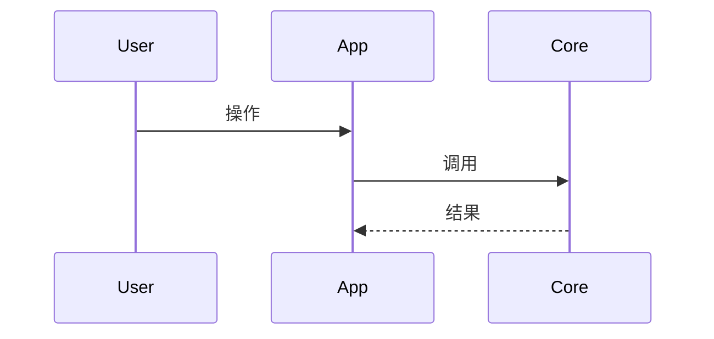

# repo_graph · CodeGraph 参考

## 安装与版本

```bash
npm i -g @colbymchenry/codegraph
codegraph --version
```

也可用官方脚本（macOS/Linux）：

```bash
curl -fsSL https://raw.githubusercontent.com/colbymchenry/codegraph/main/install.sh | sh
```

注意：全局若同时存在无关 npm 包名 `codegraph`，以实际 `codegraph --version` 与帮助文案为准；目标为 Colby McHenry 的 CodeGraph（含 `init` / `explore` / `files`）。

## 索引生命周期

| 命令 | 用途 |
|------|------|
| `codegraph init [path]` | 首次建 `.codegraph/` 并全量索引 |
| `codegraph sync [path]` | 增量同步 |
| `codegraph index [path]` | 全量重建 |
| `codegraph status [-j] [path]` | 状态与统计 |
| `codegraph unlock [path]` | 清除卡住的锁 |
| `codegraph uninit [path]` | 删除项目索引（本 Skill 默认不用） |

## 查询命令（画图常用）

| 命令 | 用途 |
|------|------|
| `codegraph files -p . --format tree --max-depth N` | 目录树 |
| `codegraph files -p . --format grouped -j` | 按语言/区段分组 |
| `codegraph explore -p . "<自然语言问题>"` | 一站式：相关源码 + 调用路径 + 影响摘要 |
| `codegraph query -p . <search> [-k kind] [-j]` | 符号搜索 |
| `codegraph node -p . <symbol\|file>` | 单点源码 + caller/callee |
| `codegraph callers\|callees -p . <symbol> [-j]` | 调用关系 |
| `codegraph impact -p . <symbol> -d 2 [-j]` | 变更影响面 |

所有支持 `-p/--path` 的命令都应对准仓库根（或 monorepo 中已索引的子包根）。

## MCP（可选）

若 Agent 已配置 CodeGraph MCP，优先工具 `codegraph_explore`；效果与 CLI `codegraph explore` 一致。未配置 MCP 时只用 CLI，不阻塞本 Skill。

```bash
codegraph install   # 向 Cursor 等写入 MCP（需用户环境允许）
```

## Mermaid 速查




节点名避免裸 `{` `}` 与未转义的特殊字符；过长标签用 `<br/>` 或缩短显示名并在文中注明全名。

## 排错

| 现象 | 处理 |
|------|------|
| `codegraph: command not found` | 安装 CLI 并开新 shell / 确认 PATH |
| 锁文件阻塞 | `codegraph unlock` 后 `sync` 或 `index` |
| 某路径无索引 | 对该路径 `init`，或探索时换已索引根 |
| 图与代码不符 | `codegraph sync` 后重跑 explore，再改 md |
| 仓库过大 | `files --max-depth` 限制深度；主流程图只保留 1–3 条路径 |

## 与 project-analysis 的边界

- `repo_graph`：索引 → 图示文件落地到 `docs/repo-graph/`。
- `project-analysis`：架构/风险/验证/下一步的分析报告；需要图时可引用 `docs/repo-graph/`，不必重复发明目录约定。
